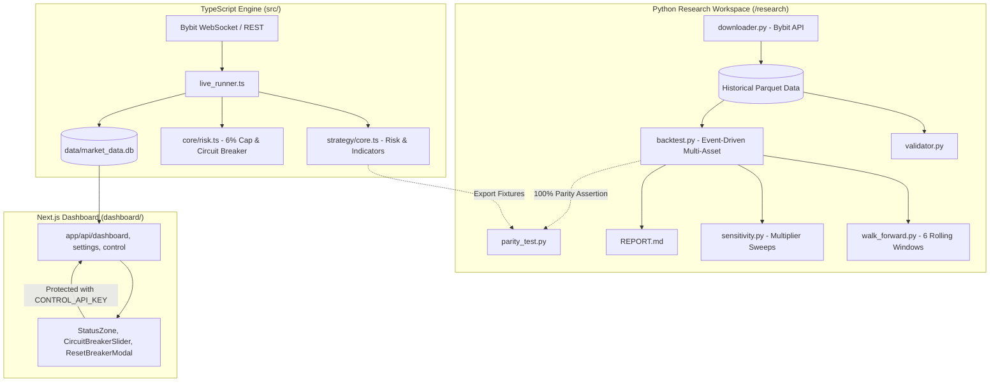

# Quantitative Crypto Trading Bot — Operational Runbook & System Handbook

**Version:** 2.0 (Hardened & Quantitatively Audited)  
**Date:** October 2026  
**Primary Engine:** TypeScript / Node.js  
**Research Environment:** Python 3.12 (`/research`)  
**Database:** SQLite (`data/market_data.db` in WAL mode)  
**Operator Interface:** Next.js 16 Web Dashboard (`http://localhost:3000`)

---

## ⚠️ MANDATORY OPERATIONAL SAFETY DIRECTIVE

> [!CAUTION]
> **DO NOT SWITCH `EXECUTION_MODE` TO `LIVE`. THE BOT MUST REMAIN IN `PAPER` MODE.**
> 
> A 2-year quantitative backtest across 12 perpetual markets (October 2024 – October 2026) verified with 100.00% parity against the TypeScript engine demonstrated that **retail directional technical indicators (EMA, RSI, ADX, Bollinger, Donchian) produce negative expectancy after real taker fees (0.06%) and slippage.**
>
> In backtesting, the original 15m strategy lost 100% of capital over 22,969 trades with an aggregate profit factor of 0.61. Alternative higher-timeframe hypotheses (4H Donchian, 4H Trend) slashed fee churn by 99% but still generated profit factors between 0.51 and 0.74.
>
> **The current engine serves as an institutional-grade paper-forward testbed and risk architecture. Real capital must NOT be risked on unproven directional logic.**

---

## 1. System Architecture & Topology



### Component Roles:
1. **TypeScript Live Engine (`src/`):** Executes real-time candle ingestion, closed-candle signal evaluation, tiered adverse slippage modeling, 8h funding accruals, position tracking, trailing stops, and circuit breakers.
2. **SQLite Database (`data/market_data.db`):** WAL-mode database holding `bot_state`, `system_state`, `active_positions`, `paper_trades`, `daily_losses`, and `activity_log`.
3. **Next.js Dashboard (`dashboard/`):** Real-time monitoring and operator control interface. Protected by API token authentication.
4. **Python Research Workspace (`research/`):** Quantitative research, high-performance vectorized indicators, event-driven backtesting, walk-forward analysis, and mathematical parity validation.

---

## 2. Environment Configuration (`.env`)

Ensure the root `.env` file is properly configured:

```ini
# Execution Mode (STRICTLY PAPER)
EXECUTION_MODE=PAPER

# Initial Capital
INITIAL_CAPITAL=10000

# Operator API Key (Secures dashboard controls and API endpoints)
CONTROL_API_KEY=dev_operator_key_change_in_production
NEXT_PUBLIC_CONTROL_API_KEY=dev_operator_key_change_in_production

# Risk Limits
MAX_OPEN_POSITIONS=10
MAX_SAME_DIRECTION_POSITIONS=6
MAX_TOTAL_OPEN_RISK=0.06       # Hard 6% total open risk cap across all positions
DAILY_CIRCUIT_BREAKER=0.05     # 5% 24h rolling drawdown trigger
CIRCUIT_BREAKER_LOCKOUT_HOURS=24

# Execution Realism
ALLOW_INTRABAR_SIGNALS=false    # STRICT: Signals only fire on confirmed closed bars
ALLOW_INTRABAR_STOPS=true       # Trailing stops remain active intra-candle for capital preservation
CORE_SLIPPAGE=0.0005            # 0.05% slippage on BTC, ETH, SOL, SUI, XRP, DOGE, PEPE
SATELLITE_SLIPPAGE=0.0012       # 0.12% slippage on lower-liquidity pairs
TAKER_FEE_RATE=0.0006           # 0.06% Bybit perpetual taker fee
```

---

## 3. Running the Live Bot (Paper Mode)

### Development / Hot-Reload
```bash
# Terminal 1: Run the TypeScript Live Engine
npm run dev

# Terminal 2: Run the Next.js Dashboard
npm run dashboard
```

### Production Build & Execution
```bash
# 1. Compile TypeScript Engine
npm run build

# 2. Build Dashboard
npm --prefix dashboard run build

# 3. Start Engine
node dist/src/live_runner.js

# 4. Start Dashboard
npm --prefix dashboard start
```
The dashboard will be accessible at: `http://localhost:3000`

---

## 4. Operator Dashboard Guide

### Dashboard Metric Tiles
- **24H DRAWDOWN:** Rolling cumulative losses over the last 24 hours divided by start-of-day equity. If this reaches or exceeds the threshold (e.g. 5.0%), the circuit breaker trips.
- **TOTAL EQUITY:** Real-time Mark-to-Market equity = Realized Cash + Unrealized PnL of open positions.
- **MARGIN USED & BUYING POWER:** Total margin currently allocated to open positions vs remaining purchasing capacity.
- **TOTAL OPEN RISK:** Sum of risk dollars across all active positions ($\text{Size} \times (\text{Entry} - \text{Stop})$). Hard-capped at **6.0%** of equity. Any proposed trade exceeding this ceiling is automatically downsized or blocked.
- **WIN RATE & TODAY PNL:** Closed trade statistics for the current 24-hour trading session.

### Circuit Breaker Controls
- **Adjusting the Threshold (Slider):** Moving the slider dynamically adjusts `circuit_breaker_limit` in SQLite via authenticated `POST /api/settings`.
  > [!NOTE]
  > Changing the slider threshold **never resets or shortens an active lockout**. If the bot is already locked out, adjusting the limit only modifies future tripping thresholds.
- **Manual Reset (Reset Breaker Button):**
  - Clicking **Reset Breaker** opens a modal with a 2-step confirmation.
  - Resetting purges the 24h rolling loss records (`daily_losses`) and clears `circuit_breaker_halted = 0` / `lockout_until = 0`.
  - **Trade History Preservation:** All `paper_trades` records and `active_positions` are strictly preserved.

### Emergency Controls
- **Pause:** Halts new entries while maintaining open positions and trailing stops.
- **Resume:** Unpauses the bot. (If the circuit breaker is still locked out, the lockout remains in effect until explicitly reset).
- **Kill Switch:** Market closes all open positions immediately and transitions system state to `PAUSED`.

---

## 5. Circuit Breaker Operation & Reset Safety

### Mechanics:
1. Every time a trade closes with a realized loss, a timestamped entry is written to `daily_losses`.
2. Every tick, `RiskManager.checkCircuitBreaker()` computes $\sum \text{losses in }[t - 24\text{h}, t]$.
3. If $\text{Losses} \ge \text{Capital} \times \text{Limit}$:
   - `circuit_breaker_halted` is set to `1`.
   - `lockout_until` is set to $t + 24\text{ hours}$.
   - System transitions to `PAUSED` with pending command `CIRCUIT_BREAKER_HALT`.

### CLI Reset Command (Script)
If the dashboard is unavailable, the operator can reset the circuit breaker via CLI:
```bash
# Requires explicit --confirm safety flag
node scripts/reset_circuit_breaker.js --confirm
```
*(Running without `--confirm` will safely exit with code 1 and execute nothing).*

### When NOT to Reset the Circuit Breaker:
- **Do NOT reset** if the market is undergoing extreme cascade liquidations or exchange network latency.
- **Do NOT reset** repeatedly on the same day if the bot hit its loss limit due to consistent adverse fills.
- **Only reset** after verifying system health, database integrity, and market stabilization.

---

## 6. Python Research Workspace (`/research`)

The `/research` workspace contains an institutional research stack built in Python 3.12.

### Activating the Python Environment
```bash
# Windows PowerShell
research\.venv\Scripts\Activate.ps1

# Windows Command Prompt
research\.venv\Scripts\activate.bat
```

### Research Tools & Workflows

1. **Download Historical 15m OHLCV & 8h Funding Rates:**
   ```bash
   python research/downloader.py
   ```
   *(Features custom DNS resolution to circumvent ISP blocking on Bybit endpoints).*

2. **Validate Data Integrity:**
   ```bash
   python research/validator.py
   ```
   *(Checks for missing bars, duplicate timestamps, corrupt prices, and extreme spikes across all Parquet files).*

3. **Run TypeScript vs Python Strategy Parity Verification:**
   ```bash
   python research/parity_test.py
   # Or via Vitest in root:
   npx vitest run tests/parity.test.ts
   ```
   *(Asserts 100.00% parity across indicators, signals, directions, and playbooks).*

4. **Run Full Multi-Asset Event-Driven Backtest:**
   ```bash
   python research/backtest.py
   ```
   *(Outputs `research/results/trade_log.csv` and `research/results/equity_curve.csv`).*

5. **Run 6-Window Rolling Walk-Forward Analysis:**
   ```bash
   python research/walk_forward.py
   ```

6. **Run Sensitivity / Fragility Sweep:**
   ```bash
   python research/sensitivity.py
   ```

7. **Run Alternative Strategy Candidates Evaluation:**
   ```bash
   python research/strategy_candidates.py
   python research/regime_and_universe_test.py
   python research/funding_yield_analysis.py
   ```

---

## 7. Logging, Inspection & Troubleshooting

### Log Files:
- Real-time engine events and state changes are written to the `activity_log` table in SQLite.
- Background process logs are located in:
  `C:\Users\<user>\.gemini\antigravity-ide\brain\<conversation-id>\.system_generated\tasks\`

### Inspecting the SQLite Database:
```bash
# Check current bot capital and circuit breaker status
sqlite3 data/market_data.db "SELECT id, capital, circuit_breaker_halted, lockout_until, circuit_breaker_limit FROM bot_state;"

# Check recent trades
sqlite3 data/market_data.db "SELECT id, symbol, side, direction, price, pnl, timestamp FROM paper_trades ORDER BY id DESC LIMIT 5;"

# Check active positions
sqlite3 data/market_data.db "SELECT symbol, side, amount, entry_price, trailing_stop FROM active_positions;"

# Check rolling daily losses
sqlite3 data/market_data.db "SELECT * FROM daily_losses ORDER BY timestamp DESC LIMIT 10;"
```

---

## 8. Summary of All 8 Project Phases

| Phase | Title | Major Accomplishments & Verification |
| :--- | :--- | :--- |
| **Phase 1** | **Research Workspace & Data Collection** | Set up Python 3.12 `.venv`. Built custom DNS Bybit downloader. Downloaded 2+ years of 15m OHLCV and 8h funding data across 12 pairs. Verified 0 duplicate/missing bars. |
| **Phase 2** | **Event-Driven Backtester** | Implemented vectorized indicators matching `technicalindicators` to $< 10^{-14}$. Built multi-asset event-driven backtester modeling 0.06% taker fees, tiered slippage, and 8h funding. |
| **Phase 3** | **Validation & Parity Audit** | Achieved **100.00% parity across 475 test points (0 mismatches)**. Proved that original 15m strategy has **no edge** (100% loss over 22,969 trades, -$6,985 in fees/slippage). |
| **Phase 4** | **Signal Timing & Realism** | Enforced closed-bar entries (`allowIntrabarSignals: false`). Implemented tiered slippage (0.05% Core, 0.12% Satellite) and 8h funding rate debits/credits in TypeScript live engine. |
| **Phase 5** | **Risk Model Hardening** | Enforced hard 6% Total Open Risk Cap. Restored trailing stops, lowest/highest prices across process restarts. Added empirical Bayes credibility shrinkage to adaptive learner ($N \ge 50$). |
| **Phase 6** | **Operator Controls & Auth** | Added `CONTROL_API_KEY` token auth on `/api/control` and `/api/settings`. Built 2-step confirmation `ResetBreakerModal`. Guaranteed trade history preservation on reset. |
| **Phase 7** | **Strategy Redesign & Sunset** | Tested 5 alternative hypotheses (4H Donchian, 4H Trend, 1H/4H Bollinger Fades, Funding Carry). Confirmed retail technical indicators lack edge; documented honest recommendation to keep in PAPER mode. |
| **Phase 8** | **Validation & Operational Runbook** | Full test suite passing (92/92 tests). TypeScript engine & Next.js dashboard production builds verified. Authored comprehensive operational handbook. |
