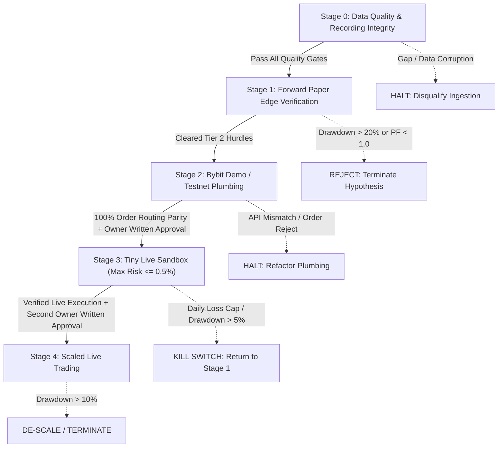

# Institutional Go-Live Criteria & Staged Deployment Ladder

**Document Version:** 1.0.0  
**Registration Date:** 2026-10-27  
**Governance Invariant:** All numeric gates, thresholds, and stop rules are set **BEFORE** inspecting intermediate outcome results. Live execution is strictly prohibited until every gate in Stages 0, 1, 2, and 3 is verified in writing.  
**Current Operating Stage:** **Stage 0 / Stage 1 (Passive Ingestion & Paper Mode Only)**.  
**Mandatory Approval Requirement:** Stages 3 (Tiny Live) and Stage 4 (Scaled Live) require explicit, signed **Owner Written Approval**. No automated agent, script, or engineer has the authority to transition to live capital.

---

## 1. Governance Principles & Pre-Commitment Architecture

To prevent narrative bias, overfitting, survivorship bias, and premature capital deployment:
1. **Pre-Registered Numeric Gates:** All criteria are fixed prior to observing strategy returns. Gates will not be relaxed after observing results.
2. **Strict Staged Progression:** Progression is strictly linear: $\text{Stage 0} \rightarrow \text{Stage 1} \rightarrow \text{Stage 2} \rightarrow \text{Stage 3} \rightarrow \text{Stage 4}$. Skipping stages or parallel live execution is prohibited.
3. **Owner Authorization Mandate:** Live capital stages (Stage 3 and Stage 4) cannot be activated by code or CI/CD pipelines. They require the owner's written confirmation specifying maximum dollar allocation and kill-switch parameters.
4. **Independent Stop Rules:** Every stage defines explicit, deterministic "kill/stop" criteria. If a stop rule is triggered, the strategy is automatically halted or demoted to an earlier stage.

---

## 2. The Staged Ladder

---

### Stage 0: Data Quality & Recording Integrity

*Objective:* Verify that market data captured by the standalone recorder daemon is complete, continuous, and institutional-grade, ensuring out-of-sample validity.

#### Numeric Gates (All Mandatory to Pass):
1. **1m Kline Coverage:** $\ge 98.0\%$ stored completeness across all tracked perpetual contracts evaluated dynamically from inception.
2. **Top-25 Orderbook Depth Coverage:** $100\%$ verified depth capture for every candidate listing during its evaluation trigger window (`launchTime + 1h` to `launchTime + 6h`).
3. **Liquidation Stream Continuity:** Zero unhandled WebSocket disconnections exceeding 60 seconds. All connection drops must be logged in `data_gaps` with explicit causes.
4. **REST Rate Limiting Headroom:** Zero sustained 429 (Rate Limit Exceeded) or 10006 (Too Many Visits) bursts. Peak request rate must remain strictly below 85 requests per 5-second window (exchange hard cap: 100 req / 5s).
5. **Contract Snapshots & Classification:** $100\%$ of hourly snapshots must store `raw_json` and parse `symbolType`. Contracts with unknown classifications must be flagged `UNKNOWN` and rejected from trading universes.

#### Stop & Disqualification Rules:
- **Immediate Disqualification:** Any undetected database write failure, schema corruption, or silent omission of delisted contracts invalidates the dataset.
- **Outage Demotion:** Any single unrecorded gap $> 60\text{ minutes}$ in orderbook depth during a listing's active window permanently excludes that event from the evaluation sample (`EXCLUDED_MISSING_DEPTH`).

---

### Stage 1: Forward Paper Trading (Edge & Alpha Verification)

*Objective:* Measure statistical edge, economic expectancy, and drawdown resistance on clean, forward-recorded out-of-sample data under realistic transaction costs.

#### Numeric Gates (Pre-Registered Tier 2 Hurdles):
1. **Sample Size:**
   - **Hypothesis A (H-A):** $N \ge 30$ clean, qualified crypto-only listings.
   - **Hypothesis B (H-B):** $N \ge 50$ clean liquidation cascade events.
2. **Evaluation Timespan:** Minimum **16 weeks** of forward recording (target Decision Date: **March 15, 2027**).
3. **Net Expectancy (After All Friction):**
   - H-A: $\ge +0.40\text{ R}$ net of VIP0 taker fees ($0.11\%$ roundtrip), realistic slippage, and accrued funding.
   - H-B: $\ge +0.32\text{ R}$ net of all friction.
4. **Net Profit Factor ($PF$):** $\ge 1.30$.
5. **Maximum Drawdown:** $\le 15.0\%$ for H-A; $\le 12.0\%$ for H-B.
6. **Bootstrap 95% Confidence Interval:** Lower bound strictly $> 0.00\text{ R}$ across 10,000 resamples.
7. **Random Trade Permutation Test:** $p < 0.05$ against 1,000 randomized entry baselines.
8. **1-Bar Execution Delay Degradation:** Net $PF \ge 1.10$ when entries are delayed by 1 full bar (verifying edge is structural, not an artifact of zero-latency fills).

#### Stop & Termination Rules:
- **Hard Termination:** If strategy cumulative drawdown exceeds **20.0%** at any point after $N \ge 15$, the strategy is permanently terminated as failed.
- **Expectancy Kill:** If Net $PF < 1.00$ after $N \ge 20$ events, paper trading is immediately halted.
- **Inconclusive Boundary:** If $PF \in [1.05, 1.29]$ or bootstrap CI spans zero, live trading remains strictly prohibited; paper collection extends to $N = 60$ or 6 months.

---

### Stage 2: Bybit Demo / Testnet Execution (Plumbing Only)

*Objective:* Verify execution engine plumbing, API authentication, WebSocket private topic handling, position reconciliation, and order routing.  
> [!IMPORTANT]
> **No Edge Evidence:** Fills, slippage, and PnL on Bybit Demo/Testnet do **NOT** count as evidence of economic edge. Testnet order books are artificial, thin, and unrepresentative of real market liquidity. Stage 2 tests plumbing only.

#### Numeric Gates (All Mandatory to Pass):
1. **Order Routing Success Rate:** $100\%$ over minimum 100 consecutive automated test orders (Market, Limit Post-Only, Stop-Market).
2. **Order Lifecycle Latency:** Mean API roundtrip (submission to acknowledgement) $< 150\text{ms}$; 99th percentile $< 350\text{ms}$.
3. **Private WebSocket Reconciliation:** Zero state discrepancies between local position state and exchange REST balance/position queries over 14 consecutive days.
4. **Precision & Rounding Conformity:** Zero `10001` or `10002` Bybit parameter errors (price filter, tick size, lot size, min order qty).
5. **Network Disconnect Recovery:** Graceful reconnection within 5 seconds on forced socket termination, with automatic open-order audit.

#### Stop & Re-Architect Rules:
- **Fatal Plumbing Error:** Any unhandled rejection, uncaught exception, or order state discrepancy immediately halts Stage 2 until code is patched and re-audited.
- **Test Reset:** 100 consecutive error-free executions must be achieved from scratch following any code change.

---

### Stage 3: Tiny Live Trading (Capital-Restricted Sandbox)

*Objective:* Verify real exchange fill mechanics, taker fee debits, real-world slippage, and live queue priorities using minimal capital.

#### Prerequisites:
1. Stage 0, Stage 1, and Stage 2 fully cleared and certified.
2. **MANDATORY OWNER WRITTEN APPROVAL:** A formal written document signed by the account owner specifying:
   - Approved live capital pool: $C_{\text{stage3}}$ (recommended: $\$100$ to $\$500$ maximum).
   - Maximum risk per trade: strictly $\le 0.50\%$ of allocated capital ($\le \$2.50$ on $\$500$).
   - Explicit exchange account UID and API key restrictions (Trading enabled, Withdrawals DISABLED).

#### Risk Gates & Automated Kill Rules:
1. **Daily Loss Cap:** **1.5% of allocated capital** in any rolling 24-hour window. If hit:
   - Automated kill switch triggers immediately.
   - All open orders cancelled; all positions closed at market.
   - Execution locked for 24 hours; alert sent to operator.
2. **Maximum Cumulative Sandbox Drawdown:** **5.0% of allocated capital**. If hit:
   - Live trading terminated immediately.
   - Capital de-allocated; strategy returned to Stage 1.
3. **Slippage Discrepancy Gate:** If average realized live slippage across 5 consecutive trades exceeds modeled slippage by $> 2.5\times$, live execution halts for model re-calibration.
4. **Exchange Disconnect Watchdog:** If WebSocket heartbeat or connection drops for $> 60\text{s}$ while holding a live position, engine automatically submits a server-side contingent stop order directly to Bybit's matching engine.

---

### Stage 4: Scaled Live Trading

*Objective:* Scale capital allocation prudently based on empirical live performance and verified low-slippage capacity.

#### Prerequisites:
1. Minimum **8 weeks** and $\ge 25$ live trades completed successfully in Stage 3.
2. **SECOND MANDATORY OWNER WRITTEN APPROVAL:** Authorizing transition from sandbox to production capital.

#### Numeric Performance Gates:
1. **Realized Live Sharpe Ratio:** $\ge 1.50$ (annualized).
2. **Live Profit Factor:** $\ge 1.25$ net of all actual exchange fees and slippage.
3. **Slippage Alignment:** Realized live slippage $\le 1.25\times$ modeled paper slippage.
4. **Drawdown Conformity:** Max live drawdown $\le 8.0\%$.

#### Capital Ladder & Scale-Back Rules:
- **Allocation Step Size:** Capital may only increase by maximum $+50\%$ increments, requiring minimum 4 weeks of profitable operation per increment.
- **Scale-Back Rule:** A drawdown of **10.0%** from peak equity automatically cuts current position sizes by **50%**.
- **Permanent Kill Rule:** A drawdown of **15.0%** from peak equity immediately liquidates all positions, terminates live trading, and revokes API credentials.
